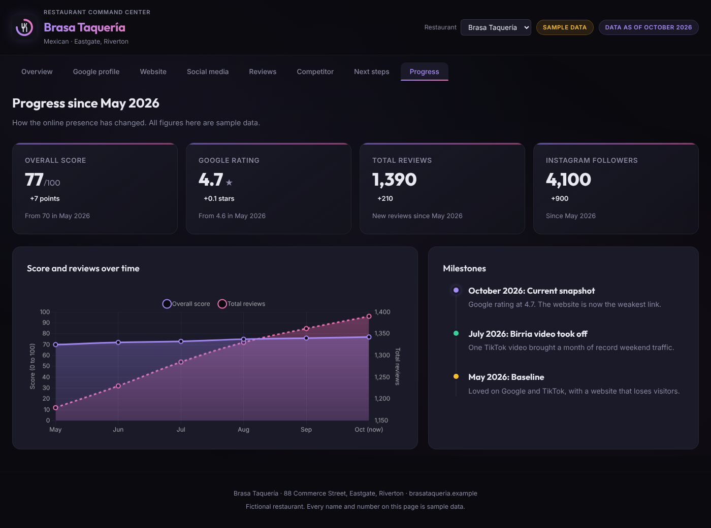

# Restaurant Command Center

A dashboard that shows how a restaurant looks online: ratings and reviews across platforms, the Google Business Profile, the website, social media, a nearby competitor, a prioritized list of next steps and progress over time.

Every restaurant is one JSON file. Drop a new file into `profiles/` and the dashboard renders it, scores it and adds it to the restaurant switcher.


> **All data in this repository is fictional.** Osteria Lumen, Brasa Taquería, their competitors, addresses and numbers are invented for the demo. The `.example` web addresses are reserved and point nowhere.

## What it shows

| Tab | What you learn |
|---|---|
| Overview | One score out of 100, how it is built, strengths, gaps, ratings and audience size |
| Google profile | Star breakdown and a profile checklist |
| Website | Phone experience, the path from visit to booking, searches worth winning, search engine basics |
| Social media | Followers, engagement, reply times, content checklist, growth ideas |
| Reviews | Volume by platform, reply habits, what diners praise and complain about |
| Competitor | Side-by-side numbers with the difference spelled out |
| Next steps | Actions grouped by timeframe and sorted into an impact and effort grid |
| Progress | Score and review trend over the past months, with milestones |


## How the score works

The overall score is a weighted average of six parts, each from 0 to 100. Weights and targets live in [`src/scoring.config.ts`](src/scoring.config.ts).

| Part | Weight | How it is measured |
|---|---|---|
| Ratings | 25 | Average rating across platforms, weighted by review count. A 1-star average scores 0, a 5-star average scores 100 |
| Review volume | 15 | Total reviews against a target of 1,500 |
| Google profile | 20 | Share of the profile checklist done (partly done counts as half) |
| Website and search | 15 | Average of the search checklist and the phone experience ratings |
| Social media | 10 | Per platform: half followers against a 5,000 target, half engagement against a 5% target. No social accounts scores 0 |
| Review replies | 15 | Share of the reply checklist done |

The current month's score is always computed from the profile. Past months come from the profile's `history`, so the chart's last point always matches the overview.

The targets suit a busy neighborhood restaurant. Change them in the config file to fit a different market.



## Run it

Requires Node 22.12 or later.

```sh
npm install
npm run dev       # local server with hot reload
npm run check     # type check, tests and production build
```

## Add a restaurant

1. Copy `profiles/_template.json` to `profiles/<your-restaurant>.json`. Files starting with `_` are ignored by the app.
2. Fill it in. `slug` becomes the address: `/?r=<slug>`. Keep `sampleData` set to `true` for invented data; the page then says so in the header and footer.
3. Run `npm run check`. If something is off (a rating above 5, star counts that don't add up to the Google review total, history months out of order), the tests name the field and the problem.

The tests require `sampleData: true` on every committed profile. That guard keeps real restaurant data out of this public repo. To use real data, keep it in a private fork and drop that one test.

The schema in [`src/schema.ts`](src/schema.ts) is the single definition of a profile. TypeScript types come from it, so the code and the data can't drift apart.

## How it is built

- **Vite + TypeScript**, no framework. Each tab is a small function in `src/render/` that turns a profile into HTML.
- **Zod** validates every profile when the app loads and in the tests.
- **Chart.js** draws the progress chart. It is installed from npm at an exact version, so the lockfile decides what ships.
- Profile text is escaped before it reaches the page, so a profile can't inject markup.
- No backend, no tracking, no API keys. The only outside request is Google Fonts.

## Where data could come from

This demo uses hand-written profiles. A production version would fill them from official sources only: the Google Business Profile API for the owner's own listing, Yelp Fusion and the Tripadvisor Content API within their display and caching rules, and the owner's own exports from Instagram, TikTok and Facebook. Each of those has terms on storing and showing data, so read them before you automate anything.

## License

Code: [MIT](LICENSE). The sample restaurants are fictional and free to reuse.
