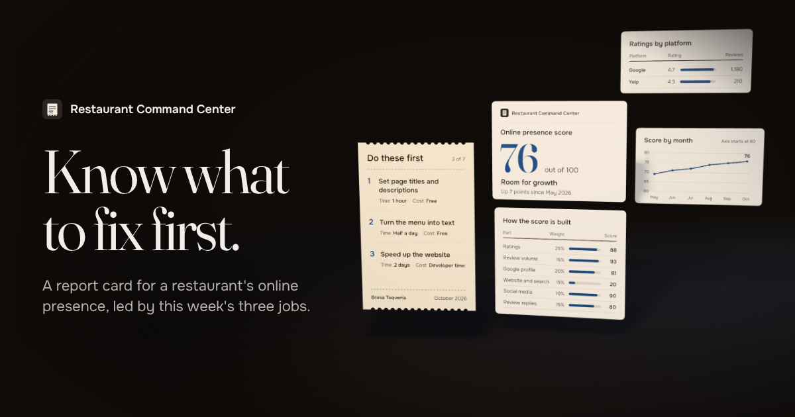
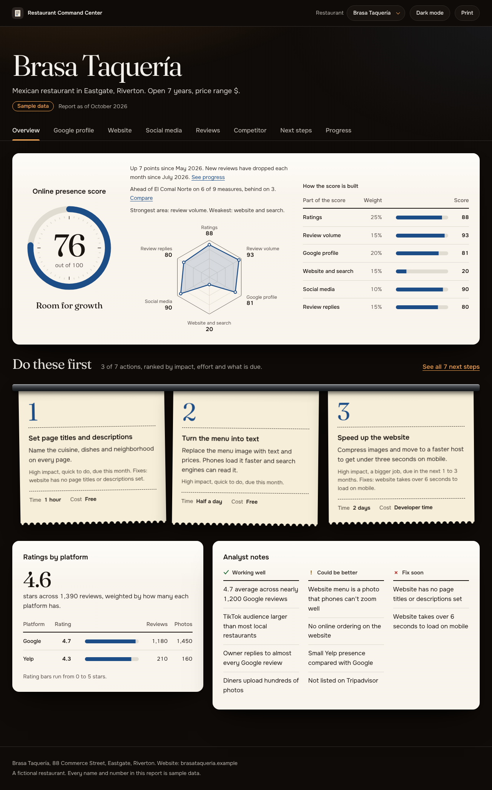
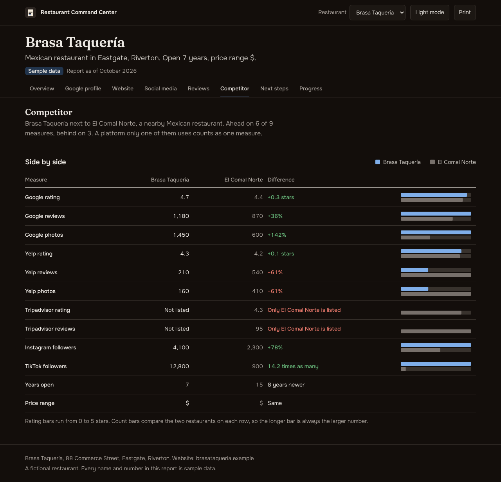
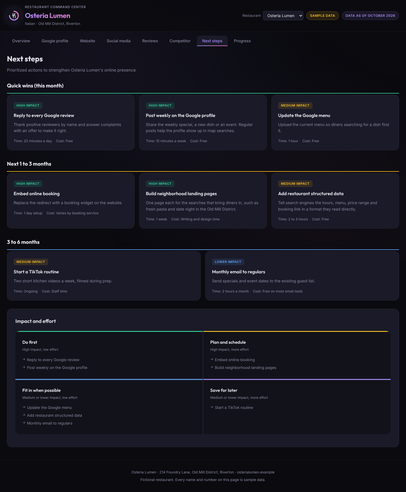

# Restaurant Command Center

[](https://github.com/TheMambi/restaurant-command-center/actions/workflows/check.yml)
[](LICENSE)

**[Open the live demo](https://restaurant-command-center-sable.vercel.app/)** or go straight to [the sample report](https://restaurant-command-center-sable.vercel.app/report/).

[](https://restaurant-command-center-sable.vercel.app/)

A report card for a restaurant's online presence. It scores how the restaurant looks online, out of 100, and leads with the three things to do first. Behind that: ratings and reviews across platforms, the Google Business Profile, the website, social media, a nearby competitor, every recommended next step and progress over time.

Every restaurant is one JSON file. Drop a new file into `profiles/` and the dashboard renders it, scores it and adds it to the restaurant switcher.

The site opens on a landing page: as you scroll, a kitchen ticket with this week's three actions lifts off a dark counter and the report behind it unfolds, rendered frame by frame from the app's own figures. The report itself lives at `/report/`.



> **All data in this repository is fictional.** Osteria Lumen, Brasa Taquería, their competitors, addresses and numbers are invented for the demo. The `.example` web addresses are reserved and point nowhere.

## What it shows

| Tab | What you learn |
|---|---|
| Overview | The score out of 100 and how it is built, the three actions to do first, ratings by platform, strengths and gaps |
| Google profile | Star breakdown and a profile checklist |
| Website | Phone experience, the path from visit to booking, searches worth winning, search engine basics |
| Social media | Followers, engagement, reply times, content checklist, growth ideas |
| Reviews | Volume by platform, reply habits, what diners praise and complain about |
| Competitor | Side-by-side numbers with the difference spelled out |
| Next steps | Actions grouped by timeframe and sorted into an impact and effort grid |
| Progress | The score and total reviews by month, with milestones |



## How the score works

The overall score is a weighted average of six parts, each from 0 to 100. Weights and targets live in [`src/scoring.config.ts`](src/scoring.config.ts).

| Part | Weight | How it is measured |
|---|---|---|
| Ratings | 25 | Average rating across platforms, weighted by review count. Most restaurants sit between 3.5 and 4.8 stars, so a 3.5 average scores 0 and 4.8 or better scores 100 |
| Review volume | 15 | Total reviews against a target of 1,500 |
| Google profile | 20 | Share of the profile checklist done (partly done counts as half) |
| Website and search | 15 | Average of the search checklist and the phone experience ratings |
| Social media | 10 | Per platform: half followers against a 5,000 target, half engagement against a 5% target. No social accounts scores 0 |
| Review replies | 15 | Share of the reply checklist done |

The current month's score is always computed from the profile. It is rounded once, from the unrounded parts, so the rounded parts on screen can add up to a point more or less; the overview says so under the table. Past months come from the profile's `history` as they were recorded at the time, and the Progress tab says so. Strengths, gaps and recommendations are analyst notes written into each profile. The app ranks the recommendations and picks the three to do first: impact counts most, bigger jobs cost a point, anything due this month gets a nudge, and any action that closes a "Fix soon" gap gets a larger one. The schema refuses a "Fix soon" gap that no action due now or soon addresses. The weights live in `actionRanking` in the scoring config.

The targets suit a busy neighborhood restaurant. Change them in the config file to fit a different market.



## Run it

Requires Node 22.12 or later.

```sh
npm install
npm run dev       # local server with hot reload
npm run check     # type check, tests and production build
npm run build && npm run preview   # serve the production build
npm run smoke     # after a build: open every view in Chrome under the production security headers
```

## Add a restaurant

1. Copy `profiles/_template.json` to `profiles/<your-restaurant>.json`. Files starting with `_` are ignored by the app.
2. Fill it in. `slug` becomes the address: `/report/?r=<slug>`. Keep `sampleData` set to `true` for invented data; the page then says so in the header and footer. `history` takes one entry for every month up to the one before `asOf`, each with that month's score as a whole number. For a platform with no reviews yet, enter 0 reviews and a rating of 0: the report says "No reviews yet" where the rating would go.
3. Run `npm run check`. If something is off (a rating above 5, star counts that don't add up to the Google review total, history months out of order or skipped), the tests name the field and the problem.

The tests require `sampleData: true` on every committed profile. That guard keeps real restaurant data out of this public repo. To use real data, keep it in a private fork and drop that one test.

The schema in [`src/schema.ts`](src/schema.ts) is the single definition of a profile. TypeScript types come from it, so the code and the data can't drift apart.

## Features

- **Pick a restaurant** from the top bar. The restaurant and tab live in the address (`/report/?r=osteria-lumen&tab=competitor`), so any view can be shared as a link. Links in the older form (`/?r=…`) still open the report.
- **Light and dark mode**, following the system setting until you choose. The counter stays dark in both; light mode lays paper sheets on it, dark mode lays dark steel ones.
- **Print or save as PDF** turns the whole report, every section in order, into ink on white paper an owner can keep.
- **Works on a phone.** Wide tables restack into labelled rows, and bars give way to the numbers.
- **Honest numbers.** Bars start at zero, each chart has one axis, a missing platform is named as a gap instead of drawn as zero, a listing with no reviews shows no rating, the competitor table compares a figure only when both restaurants have it, and estimates show as High, Medium or Low instead of made-up scores.
- **Accessible.** Keyboard tabs (arrow keys, Home, End), visible focus, status shown in words as well as colour, charts backed by data tables for screen readers. The test suite runs axe-core on every tab; colour contrast was checked in Chrome in both modes.

## How it is built

- **Vite + TypeScript**, no framework, two pages: the landing page (`index.html`, `src/landing.ts`) and the report (`report/index.html`, `src/main.ts`). Each report tab is a small function in `src/render/` that turns a profile into HTML.
- **The landing hero** draws 120 pre-rendered AVIF frames on a canvas as you scroll, driven by [Motion](https://motion.dev)'s `scroll()`. The frames are a three.js scene (the ticket and plates on a brushed steel pass under a heat lamp) rendered with [HyperFrames](https://github.com/heygen-com/hyperframes) from the app's colour tokens, fonts and Brasa Taquería's computed report; the source and how to re-render it are in [`hero-sequence/`](hero-sequence/README.md). With reduced motion on, the page shows the finished frame instead.
- **Zod** validates every profile when the app loads and in the tests.
- **Charts and drawings are hand-written SVG** (`src/render/line-chart.ts`, `src/render/visuals.ts`): the score plate, the six-part wheel, split bars, sparklines, and line and bar charts with one series and one axis. No chart library.
- **Tests** cover the schema, scoring, the security policy and its rules for markup, every tab's rendering, keyboard tabs and address state in a simulated browser, the landing page's frame maths and redirects, a check that the hero frames match the current figures, and axe-core accessibility checks on both pages.
- **Fonts are self-hosted** from npm (Fraunces and Onest), so the page makes no outside requests.
- Profile text is escaped before it reaches the page, and markup enters through one function, so a profile can't inject markup.
- **Locked down in the browser.** A Content-Security-Policy allows scripts, styles, fonts and images from the site alone, with no inline scripts or styles and Trusted Types on; the pages can't be framed. Details in [`SECURITY.md`](SECURITY.md).
- No backend, no tracking, no API keys.

## Design

The look is documented in [`DESIGN.md`](DESIGN.md): the pass during service. The page is a dark steel counter under a heat lamp, and the report lies on it as lit sheets. "Do these first" hangs as three tickets from a steel rail, and the score sits on a plate whose rim fills from 0 to 100. The lamp's ember marks controls, ink blue marks data, and red, amber and green mean status and always come with a word. Every colour and font goes through a token, labels are sentence case, each chart has one y-axis and motion only answers the visitor.

## Decisions and trade-offs

- **Static and offline-first.** No backend means no accounts to secure and nothing to break on a free host. The cost: profiles are files, so updating a restaurant means a commit.
- **One score, shown with its parts.** A single number is easy to act on and easy to distrust, so the overview always shows the weights and each part's score beside it.
- **Lead with actions.** Owners don't need another chart; they need to know what to do this week. The three tickets hang right under the score.
- **Hand-written SVG over a chart library.** Two small chart types cost under 150 lines and cut the report's JavaScript from about 300 KB to about 140 KB. The landing page adds Motion and comes to about 210 KB.
- **Rendered frames over live 3D or AI video.** A live three.js scene would cost every visitor a large download and a busy GPU; AI video garbles small text. The hero is rendered once from the real tokens, fonts and figures, so every label stays sharp, and it weighs about 3 to 5 MB per screen size (2560 or 3200 pixels across for wide screens, 1080 for phones). The first and last frames and every sixteenth (about 0.5 MB with the rest of the page) load at once; the rest wait for the first scroll, so a visitor who never scrolls skips them. Frames are decoded ahead of the scroll into a small window of ready bitmaps, so a scrub never waits on a decode.
- **Vite over Next.js.** A Next.js rewrite was on the table for the landing page. Motion's framework-free API gives the same scroll-linked animation on the current stack, so the report, its tests and its hosting stayed as they were.
- **Fictional data only.** The project began as a dashboard for a real restaurant. Without the owner's written permission, nothing from it is public; a test refuses any committed profile not marked as sample data.

## Where data could come from

This demo uses hand-written profiles. A production version would fill them from official sources only: the Google Business Profile API for the owner's own listing, Yelp Fusion and the Tripadvisor Content API within their display and caching rules, and the owner's own exports from Instagram, TikTok and Facebook. Each of those has terms on storing and showing data, so read them before you automate anything.

## License

Code: Copyright (C) 2026 The Mambí. This program is free software: you can redistribute it and/or modify it under the terms of the GNU Affero General Public License as published by the Free Software Foundation, either version 3 of the License, or (at your option) any later version. See `LICENSE` for the full text.

The sample restaurants are fictional and free to reuse.
